# 🚀 Awesome Demand-Side Platform (DSP)

**A curated index of top Demand-Side Platforms (DSPs), OpenRTB bidder engines, programmatic advertising frameworks, and media-buying toolkits.**

*Focused on Programmatic Advertising, Real-Time Bidding (RTB), OpenRTB 2.x/3.0, Media Buying, Header Bidding, and AI-Driven Campaign Optimization.*

**Last updated: October 2026**

---

## 📖 Overview

A **Demand-Side Platform (DSP)** is an adtech platform that enables digital advertisers, brands, and agencies to purchase ad impressions across various publisher sites, apps, Connected TV (CTV) networks, and digital audio platforms in automated, real-time auctions via **Real-Time Bidding (RTB)** and **OpenRTB protocols**.

This curated repository tracks both leading enterprise **SaaS / commercial DSP platforms** and active **open-source RTB bidding engines**, protocol implementations, and DSP frameworks.

---

## 📑 Table of Contents

- [📊 Sector Overview & Market Dynamics](#-sector-overview--market-dynamics)
- [🏢 SaaS/Hosted Platforms](#-saashosted-platforms)
- [🔓 Open-Source GitHub Projects](#-open-source-github-projects)
  - [⚡ Bidders & DSP Engines](#-bidders--dsp-engines)
  - [🌐 OpenRTB Protocols & Toolkits](#-openrtb-protocols--toolkits)
  - [📡 Header Bidding & Auction Infrastructure](#-header-bidding--auction-infrastructure)
- [🛠️ Architecture & Building Blocks](#-architecture--building-blocks)
- [🤝 How to Contribute](#-how-to-contribute)
- [💖 Support](#-support)
- [📜 Disclaimer](#-disclaimer)
- [⭐ Star History](#-star-history)

---

## 📊 Sector Overview & Market Dynamics

The global **Demand-Side Platform (DSP)** market is estimated at approximately **$48 billion to $52 billion in 2026**, expanding at an annual compound growth rate (CAGR) of roughly **19% to 24%**, propelled by Connected TV (CTV), omnichannel identity resolution, retail media networks, and autonomous AI-driven bidding agents. 

The sector exhibits a classic **barbell market structure**:
* **Top-Tier Concentration:** The top 5 market leaders (Google Display & Video 360, The Trade Desk, Amazon DSP, Adobe Advertising Cloud, and Microsoft/Criteo) control nearly **47%** of overall global programmatic spend.
* **Ecosystem Fragmentation:** Over **100+ active commercial DSPs** and niche providers compete across regional markets, specialized verticals (e.g., in-app mobile gaming, native ads, audio, localized commerce), and private marketplace (PMP) ecosystems.

---

## 🏢 SaaS/Hosted Platforms

The table below lists prominent commercial Demand-Side Platforms ranked in descending order by parent company scale (revenue / market valuation), along with concrete starting tier pricing models and free trial specifications.

| Platform | Revenue / Valuation (Descending) | Description | Pricing Model & Starting Tier | Free Tier / Trial Limit |
| :--- | :--- | :--- | :--- | :--- |
| **[Amazon DSP](https://advertising.amazon.com/solutions/products/amazon-dsp)** | ~$2.0T+ Market Cap (~$638B Revenue) | Amazon's demand-side platform offering direct access to Amazon owned-and-operated inventory (Prime Video, Twitch, Freevee), audiences, and third-party exchanges. | CPM-based model with $0 minimum spend on self-serve direct access ($3,000–$5,000/mo recommended effective floor; managed-service tier requires $50,000/mo minimum commit). | No free tier or trial; requires funding working media spend (no sandbox trial credits). |
| **[Google Display & Video 360 (DV360)](https://marketingplatform.google.com/about/display-video-360/)** | ~$2.0T+ Market Cap (~$350B Revenue) | Google’s enterprise demand-side platform for cross-channel display, video, audio, and CTV with deep YouTube and Google ecosystem integration. | Percentage-of-media fee (~12%–15% take-rate); accessible via partner resellers starting at $2,000–$5,000/month media spend (direct Google enterprise contracts require six-figure annual commitments). | No free tier or trial; demo access is strictly available via sales-assisted walkthroughs. |
| **[Adobe Advertising Cloud](https://business.adobe.com/products/adobe-advertising-cloud.html)** | ~$150B–$200B Market Cap (~$21.5B Revenue) | Enterprise DSP natively integrated with Adobe Experience Cloud for cross-channel programmatic buying, audience activation, and attribution. | Enterprise software subscription plus tech fee percentage of media spend; starting commitments typically start at $10,000+/month ($100,000+/year contract). | No free tier or trial; platform evaluation is available only through scheduled enterprise guided demos. |
| **[The Trade Desk](https://www.thetradedesk.com/)** | ~$35B–$45B Market Cap (~$2.9B Revenue) | Premier independent DSP known for transparent auctions, CTV leadership, and omnichannel reach across the open internet. | Platform tech fee of ~15%–20% of gross media spend; direct enterprise seats require a minimum spend commit of $100,000/quarter ($33,000+/month) or via resellers at lower minimums. | No free tier or trial; live bidder infrastructure requires enterprise contract execution. |
| **[Yahoo DSP](https://www.yahooinc.com/advertising)** | ~$20B Valuation (~$7B Revenue) | Omnichannel DSP under Apollo Global Management providing access to Yahoo native inventory and global programmatic supply with identity graph solutions. | CPM/percentage-of-spend fee structure; accessible through self-serve and partner tiers with minimum spend starting at ~$2,500–$5,000/month. | No free tier or trial; live bidding requires active campaign funding and credit approval. |
| **[Criteo](https://www.criteo.com/)** | ~$1.5B–$2.0B Market Cap (~$1.9B Revenue) | Commerce-focused DSP and retail media platform specializing in dynamic product retargeting and open-web performance advertising. | Self-serve CPC/CPM model with no platform subscription fee; campaigns start at $0 minimum spend (promotional ad-credit matching offers require meeting an initial $500 spend threshold). | No free tier or trial; requires paying for clicks/impressions delivered (matched ad-credit promos offered periodically). |
| **[Viant](https://www.viantinc.com/)** | ~$800M–$1.0B Market Cap (~$344M Revenue) | People-based omnichannel DSP powered by ViantAI, focusing on household-level identity resolution and CTV advertising. | Choice of SaaS monthly subscription licensing fee starting around $2,500/month or percentage-of-media spend agreements tailored via custom master service contract. | No free tier or trial; interactive product demos provided upon qualified sales consultation. |
| **[Amobee](https://www.amobee.com/)** *(Nexxen)* | ~$500M Market Cap (~$380M Revenue) | Omnichannel and Connected TV DSP acquired by Nexxen (formerly Tremor International) for cross-screen data-driven planning and activation. | Dynamic CPM and programmatic tech-fee model starting at ~$5,000/month minimum media spend under Nexxen platform agreements. | No free tier or trial; prospective agency clients can request custom platform walkthroughs. |
| **[Basis Technologies](https://basis.com/)** | ~$155M Revenue (Private) | Comprehensive media automation platform unifying DSP capabilities with campaign planning, workflow management, and financial reconciliation. | All-inclusive tech fee bundled into working media spend (~10%–15% effective fee) with flexible entry terms ($0 strict contract minimum for independent agency seats). | No free tier or trial; offers a 1-day live interactive personalized demo upon onboarding request. |
| **[MediaMath](https://www.mediamath.com/)** *(Infillion)* | ~$100M Revenue (Private) | Pioneer programmatic DSP acquired and relaunched by Infillion, offering composable architecture, algorithmic bidding, and omnichannel DSP execution. | Modular tech fee pricing starting at ~10%–15% of media spend; custom contract tiers start with minimum monthly commitments of ~$3,000–$5,000. | No free tier or trial; live test seats require Infillion master services agreement onboarding. |

---

## 🔓 Open-Source GitHub Projects

Commercial DSPs dominate large-scale media buying due to carrier connections, credit lines, and proprietary fraud prevention. However, open-source projects provide the foundational building blocks—including low-latency C++ / Go bidding engines, auction simulators, and OpenRTB serializers—for engineering teams building self-hosted, private programmatic bidders.

All repositories are sorted in descending order by GitHub stargazer count. Each repository includes a social Stars_Badge linking directly to its stargazers page.

### ⚡ Bidders & DSP Engines

- **[RTBkit](https://github.com/rtbkit/rtbkit)**   
  Classic C++ open-source software package for building and deploying real-time bidders for display advertising. One of the earliest, widely cited open DSP architectures.

- **[vanilla-rtb](https://github.com/venediktov/vanilla-rtb)**   
  High-performance C++14 cross-platform bidder engine and framework designed for sub-10ms RTB bidding and customizable DSP development.

- **[OpenDSP](https://github.com/javagossip/opendsp)**   
  Open-source mobile-focused DSP platform featuring built-in mainstream AdX integrations, budget management, and an administration dashboard.

- **[rapid-bidder](https://github.com/vanilla-rtb/rapid-bidder)**   
  Ready-to-run DSP application built on top of the vanilla-rtb stack demonstrating real-time bidding, campaign handling, and pacing algorithms.

- **[Zhuque](https://github.com/javagossip/zhuque)**   
  Comprehensive all-in-one open-source digital advertising suite featuring modular implementations of DSP, SSP, Ad Exchange (AdX), and DMP services.

- **[Eyevinn DSP](https://github.com/Eyevinn/demand-side-platform)**   
  Lightweight open-source DSP implementation crafted in Node.js/TypeScript designed for video ad testing, VAST/VPAID workflows, and educational RTB simulation.

- **[AdProX (ad_prox_dsp)](https://github.com/nayan9229/ad_prox_dsp)**   
  High-throughput Go-based programmatic DSP supporting OpenRTB, VAST XML, native creatives, real-time bid evaluations, and ad fraud mitigation.

- **[VOXDSP](https://github.com/VOXDSP/VOXDSP)**   
  OpenRTB-compliant Demand-Side Platform and bidder built for high-performance bid request handling, campaign targeting, and impression tracking.

- **[BlazeDSP](https://github.com/BlazeDSP/BlazeDSP)**   
  Cloud-native open-source Demand-Side Platform designed with a focus on fault tolerance, horizontal scaling, and low-latency cloud infrastructure.

- **[open-adx](https://github.com/javagossip/open-adx)**   
  Open-source Ad Exchange (AdX) engine providing auction mechanics and exchange endpoints for testing and operating with custom DSP bidders.

---

### 🌐 OpenRTB Protocols & Toolkits

- **[OpenRTB (openrtb/OpenRTB)](https://github.com/openrtb/OpenRTB)**   
  Official community and issue tracking repository for the OpenRTB standard that unifies programmatic real-time bidding protocols globally.

- **[IAB OpenRTB](https://github.com/InteractiveAdvertisingBureau/openrtb)**   
  Core specification schemas and protocol documentation maintained by the Interactive Advertising Bureau (IAB) Tech Lab.

- **[bsm/openrtb](https://github.com/bsm/openrtb)**   
  Blazing-fast OpenRTB protocol data models and JSON serialization / deserialization library for Go (Golang).

- **[InteractiveAdvertisingBureau/openrtb2.x](https://github.com/InteractiveAdvertisingBureau/openrtb2.x)**   
  Official specifications, release notes, and reference materials for OpenRTB version 2.6 and subsequent revisions.

- **[mxmCherry/openrtb](https://github.com/mxmCherry/openrtb)**   
  Comprehensive Go implementation of OpenRTB 2.x, OpenRTB 3.0, AdCOM 1.0, and Native 1.2 models with zero-allocation JSON handling.

---

### 📡 Header Bidding & Auction Infrastructure

- **[Prebid.js](https://github.com/prebid/Prebid.js)**   
  The leading open-source header bidding client-side framework used by thousands of publishers to run fair auctions among multiple DSPs and SSPs simultaneously.

- **[prebid-server](https://github.com/prebid/prebid-server)**   
  High-performance server-side header bidding and auction orchestration engine (written in Go & Java) enabling cloud auctions with low latency.

- **[OpenSSP](https://github.com/ad-tech-group/openssp)**   
  Open-source Supply-Side Platform (SSP) and exchange connector built to bridge publisher inventory directly into OpenRTB-compliant DSP bidders.

---

## 🛠️ Architecture & Building Blocks

When architecting a self-hosted or hybrid DSP solution:
1. **Core Bidder Engine:** Use **vanilla-rtb** or **RTBkit** to evaluate bid requests under 10–20ms.
2. **Protocol Serialization:** Integrate high-throughput OpenRTB libraries such as **bsm/openrtb** or **mxmCherry/openrtb**.
3. **Auction Testing:** Deploy **prebid-server** or **open-adx** as an auction counterpart to test bid generation, pacing, and win rates.
4. **Data & Pacing Layer:** Utilize in-memory caches (Redis/Aerospike) for budget frequency capping and dynamic audience segment lookup.

---

## 🤝 How to Contribute

Contributions are welcome! Please follow these simple steps:

1. 🍴 Fork the repository.
2. 🌿 Create a new feature branch (`git checkout -b feature/add-new-dsp`).
3. ✏️ Add or update entries in `README.md` keeping descriptions factual, concise, and linked to official sources.
4. 🚀 Commit your changes and open a Pull Request.

---

## 💖 Support

Thank you for exploring this repository! If you find this curated DSP collection useful, please consider:
- ⭐ **Starring** the repository on GitHub.
- 🍴 **Forking** and contributing new platforms, benchmarks, or bidder engines.
- 📢 **Sharing** with your fellow adtech engineers, programmatic traders, and digital marketers.
- ☕ **Sponsoring**: If you would like to buy a coffee or support ongoing maintenance, visit the [GitHub Sponsor Dashboard](https://github.com/sponsors/ishandutta2007).

---

## 📜 Disclaimer

* This is a **community-curated list** provided for educational, analytical, and technical reference purposes.
* Demand-Side Platforms execute real-time automated financial transactions and process consumer behavioral data. Operating a production DSP requires extensive technical safeguards, legal compliance (such as GDPR, CCPA, and COPPA), fraud prevention tools, and privacy consent frameworks.
* This repository does not constitute financial, legal, or investment advice.

---

## ⭐ Star History

